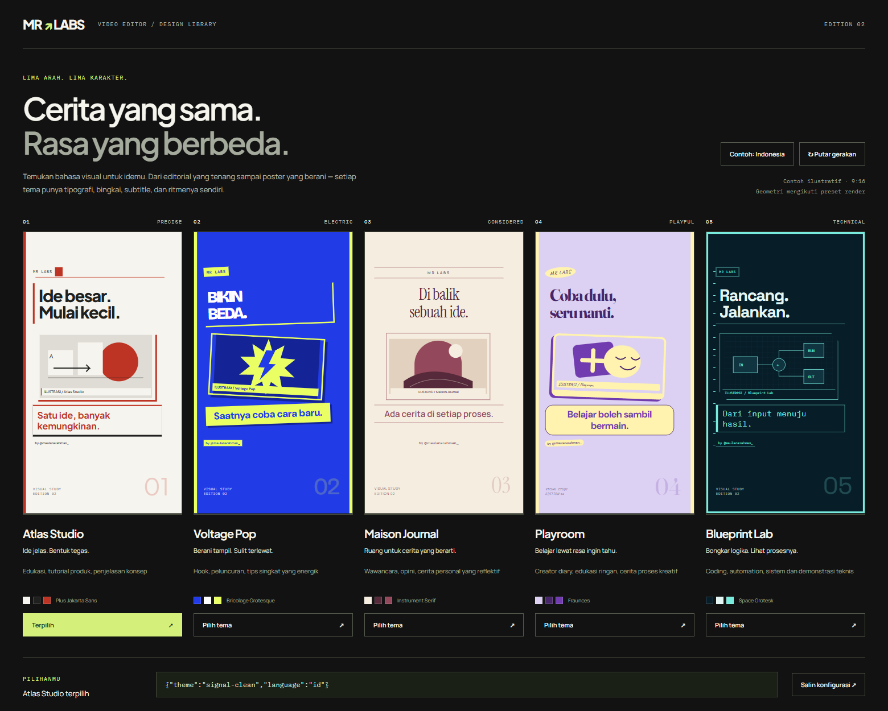

# MR Labs Video Editor

Skill editor video asli dengan bahasa Indonesia sebagai default, dukungan Inggris/campuran, B-roll kontekstual, 15 paket visual, 12 keluarga font OFL + opsi Helvetica lokal, dan 10 SFX CC0.

Skill berada di [`skills/mrlabs-video-editor/SKILL.md`](skills/mrlabs-video-editor/SKILL.md). Buka [`theme-gallery.html`](skills/mrlabs-video-editor/assets/theme-gallery.html) di browser untuk membandingkan paket, melihat font dan mendengarkan SFX. File galeri bekerja lokal tanpa akun. GitHub menampilkan source HTML; unduh/clone repo lalu buka file tersebut.

Snapshot koleksi Original (edisi 02); galeri HTML memuat seluruh 15 tema terbaru.



Hasil dan batas pengujian lokal: [`VALIDATION.md`](VALIDATION.md).

| Paket | Kegunaan |
|---|---|
| Atlas Studio | Editorial merah-putih untuk edukasi dan tutorial |
| Voltage Pop | Poster biru elektrik untuk hook dan tips cepat |
| Maison Journal | Majalah ivory/wine untuk opini dan wawancara |
| Playroom | Kolase lilac/butter untuk cerita kreatif dan edukasi ringan |
| Blueprint Lab | Diagram navy/cyan untuk coding dan automation |
| Peach Doodle | Coretan peach dengan bingkai organik |
| Bubble Pop | Gelembung lilac/pink dan kapsul bulat |
| Groovy Mint | Gelombang retro mint/lavender |
| Sunny Picnic | Pola bunga kuning dan bentuk kelopak |
| Orbit Candy | Orbit dan bintang di latar ungu malam |
| Verge Glass | Latar hitam `#0A0A0C` & bento beraksen biru es untuk review tech & produktivitas |
| Monocle Brief | Latar putih `#FFFFFF` & kolom pers hijau emerald untuk bisnis & finansial |
| Kinfolk Linen | Latar putih `#FFFFFF` & serif tenang untuk quiet luxury & lifestyle |
| Obsidian Studio | Latar hitam `#0A0A0A` & emas sampanye untuk podcast & personal brand |
| Founder Slate | Latar putih `#FFFFFF` & kartu pitch-deck kobalt untuk founder, AI & studi kasus |

Lima tema Original merupakan remake edisi 02; lima tema Fun berpola ditambahkan pada edisi 03; lima tema Pro Influencer berlatar putih dan hitam ditambahkan pada edisi 04. Jika video sumber sudah mendukung format potrait (`height > width`), latar belakang tema otomatis dilewati sehingga video potrait langsung tampil penuh tanpa latar tambahan. Galeri dan video memakai CSS preset yang sama. Poppins Bold (700), Roboto (400) dan Roboto Light (300) dibundel; Helvetica memakai font lokal berlisensi dengan fallback Roboto. ID konfigurasi sebelumnya tetap didukung; lihat [pemetaan tema dan perilaku render](skills/mrlabs-video-editor/references/visual-packs.md).

Untuk Codex atau agen kompatibel, arahkan ke `SKILL.md`, atau salin folder skill ke direktori skill pribadi lalu invoke `$mrlabs-video-editor`. Penempatan repo tidak otomatis memasang skill ke semua aplikasi.

```text
Gunakan skill di skills/mrlabs-video-editor/SKILL.md.
Edit video yang saya tentukan dengan subtitle Indonesia.
Tampilkan pilihan tema dan rencana edit bertimestamp dahulu.
Gunakan B-roll yang menjelaskan isi ucapan dan pertahankan suara asli.
```

Perintah lengkap dan format proyek: [`commands.md`](skills/mrlabs-video-editor/references/commands.md). Pemeriksaan aset tanpa unduhan:

```powershell
python skills/mrlabs-video-editor/scripts/mrlabs-assets.py
python -m unittest discover -s skills/mrlabs-video-editor/tests -v
```

Alur: pilih sumber → transkripsi → rencana edit → persetujuan yang berlaku → assembly → B-roll/visual → preview → render → pemeriksaan video dan dengar audio. B-roll dicari oleh agen menggunakan alat web, lalu dicatat dalam ledger; helper Python tidak mengklaim integrasi API stok. Profil render v1: 1080×1920, 30fps.

Implementasi MR Labs baru, terinspirasi workflow [tenfoldmarc/video-edit-skill](https://github.com/tenfoldmarc/video-edit-skill) oleh [@tenfoldmarc](https://www.instagram.com/tenfoldmarc/). Tidak menyertakan salinan script/template upstream. Dependensi runtime memiliki lisensi masing-masing. Font dan SFX beserta asal dan hash-nya tercatat dalam [`catalog.json`](skills/mrlabs-video-editor/assets/catalog.json); lisensi individual dibundel. Tidak ada footage pribadi, model Whisper, virtual environment atau hasil produksi yang perlu di-commit.
